# Cubrí Seguros — contratación digital de seguro de celular

Prototipo académico realizado con HTML5, Tailwind CSS v4 por CDN, Basecoat CSS y JavaScript vanilla con módulos ES. No utiliza frameworks ni backend. El pago es simulado y no genera una póliza real.

## Enlaces

- **Sitio publicado:** [Cubrí Seguros](https://cubriseguros-caire.netlify.app/)
- **Repositorio:** [sofiacaire/cubri-seguros](https://github.com/sofiacaire/cubri-seguros)

## Cómo ejecutar

1. Descargá o cloná el repositorio.
2. Abrí la carpeta con Visual Studio Code.
3. Ejecutá `index.html` con la extensión **Live Server** (recomendado), o desde una terminal dentro de la carpeta ejecutá `python -m http.server 8000` y abrí `http://localhost:8000`.
4. No abras el HTML con doble clic (`file://`), porque `fetch()` necesita un servidor local para cargar `data/planes.json`.

El proyecto utiliza CDN para Tailwind CSS, Basecoat CSS e Inter, por lo que requiere conexión a internet para esos recursos.

## Estructura

```text
cubri-seguros/
├── index.html
├── capturas/
│   ├── inicioDesktop.png
│   ├── inicioMobile.jpeg
│   ├── cotizacionDesktop.png
│   ├── cotizacionMobile.jpeg
│   ├── planesDesktop.png
│   ├── planesMobile.jpeg
│   ├── datospersonalesDesktop.png
│   ├── datospersonalesMobile.jpeg
│   ├── pagoDesktop.png
│   ├── pagoMobile.jpeg
│   ├── exitoDesktop.png
│   ├── exitoMobile.jpeg
│   ├── errorDesktop.png
│   └── errorMobile.jpeg
├── css/
│   └── tokens.css
├── data/
│   └── planes.json
├── js/
│   ├── app.js
│   ├── estado.js
│   ├── render.js
│   ├── validaciones.js
│   ├── cotizador.js
│   └── pago.js
└── README.md
```

## Funcionalidades implementadas

- Catálogo con cuatro productos; solo Celular está habilitado.
- Flujo de cuatro pasos con stepper, navegación hacia atrás y estado centralizado en `solicitud`.
- Carga de planes desde JSON local mediante `fetch()`.
- Cotización de Básico, Plus y Premium; Plus preseleccionado como recomendado.
- Validaciones de equipo, datos personales y tarjeta; errores accesibles en línea.
- Resumen del seguro que se actualiza desde el estado y se adapta a mobile/desktop.
- Pago simulado con demora de 1,5 segundos, pantalla de éxito o error y reintento conservando los datos.
- Generación de número de póliza con formato `POL-AAAA-NNNNNN`.
- Diseño responsive mobile-first.

## Reglas de cálculo

`cuota = Math.round(valor * tasaAnual / 12 * factorAntiguedad)`

| Plan | Tasa anual | Coberturas |
|---|---:|---|
| Básico | 4% | Robo con violencia |
| Plus | 6% | Robo con violencia, rotura de pantalla |
| Premium | 9% | Robo con violencia, rotura total, hurto/pérdida |

Factores: menos de 1 año = 1,00; 1 a 2 años = 1,10; más de 2 años = 1,25.

## Casos de prueba de cotización

| Valor del equipo | Antigüedad | Básico | Plus | Premium |
|---:|---|---:|---:|---:|
| $600.000 | Menos de 1 año | $2.000 | $3.000 | $4.500 |
| $600.000 | 1 a 2 años | $2.200 | $3.300 | $4.950 |
| $1.200.000 | Más de 2 años | $5.000 | $7.500 | $11.250 |

## Tarjetas de prueba

- `4111 1111 1111 1111` → aprobado.
- `4000 0000 0000 0002` → rechazado; permite probar la pantalla de error y el reintento.
- Cualquier otro número de 16 dígitos válido según las reglas del ejercicio → aprobado.


## Capturas mobile y desktop

### Inicio

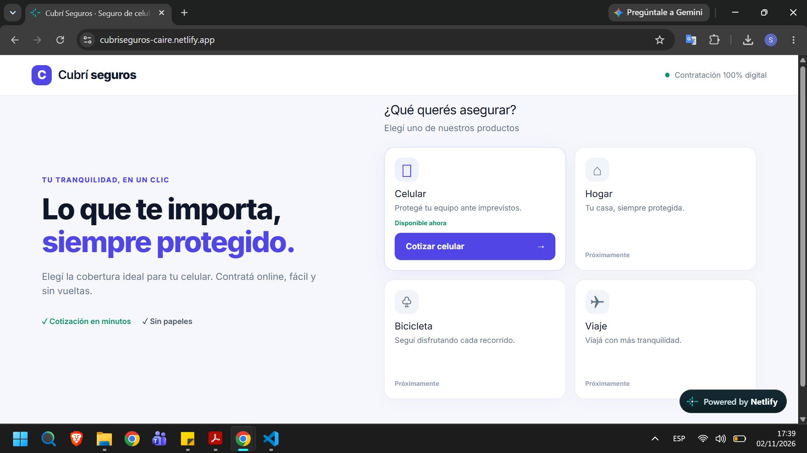


### Cotización

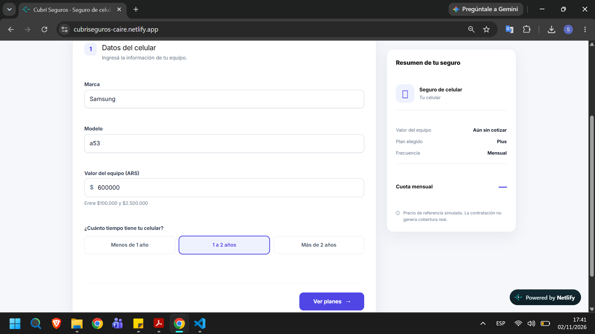

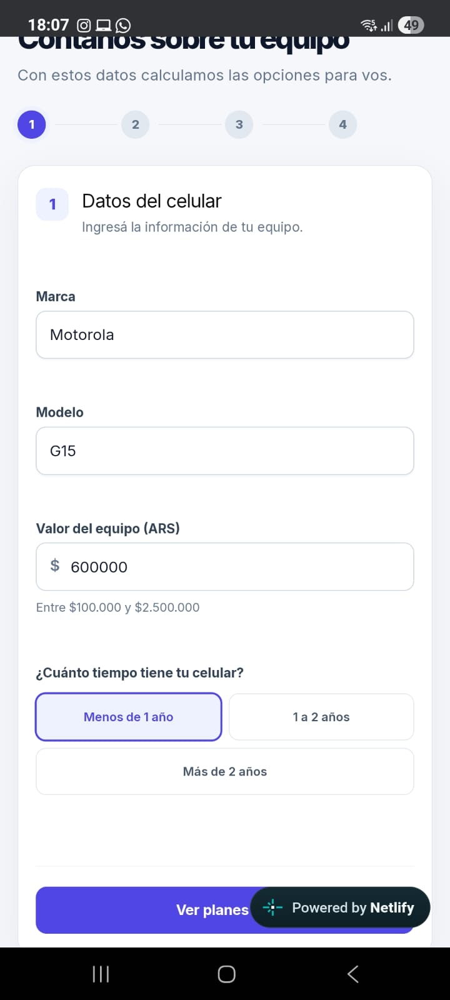

### Planes

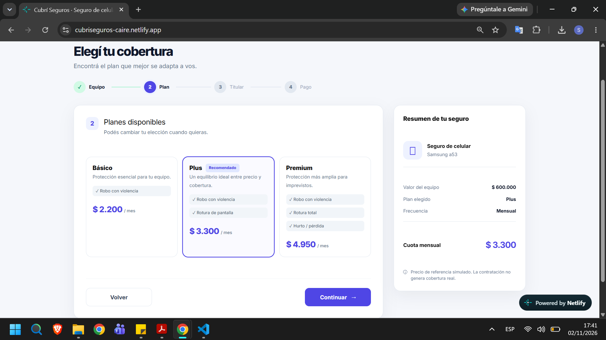

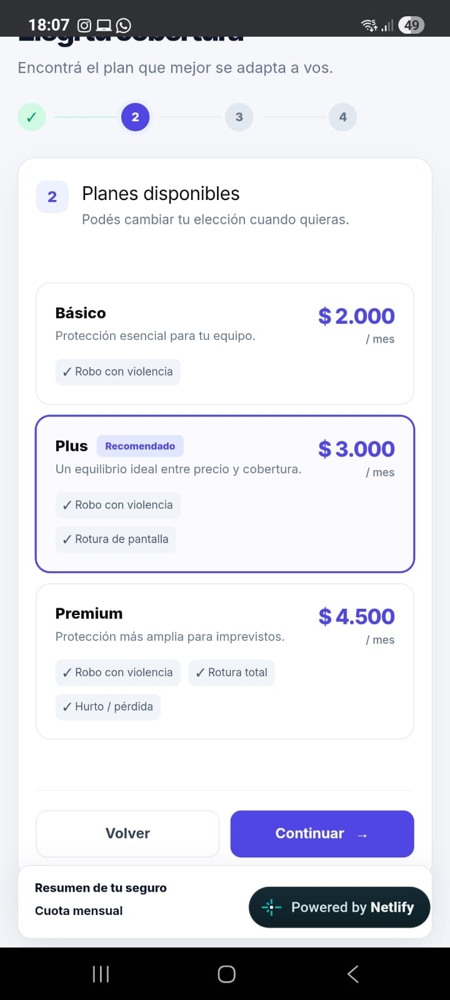

### Datos personales

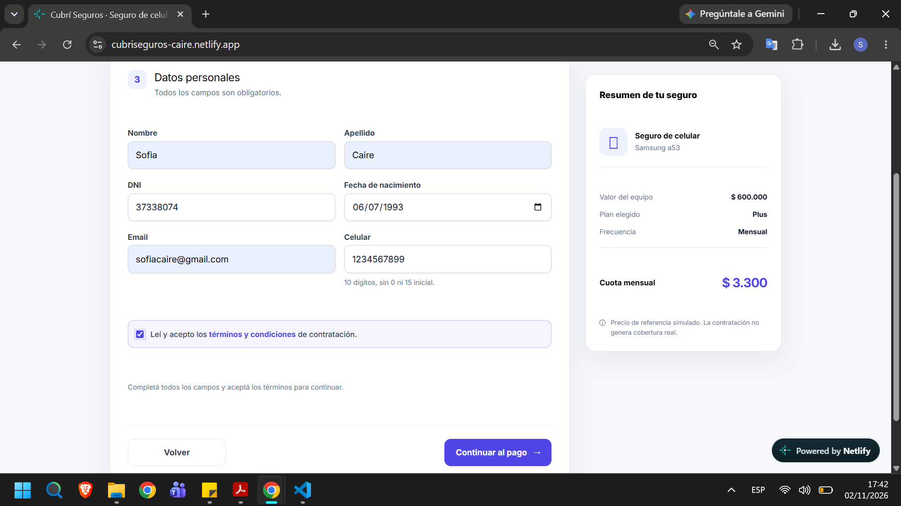

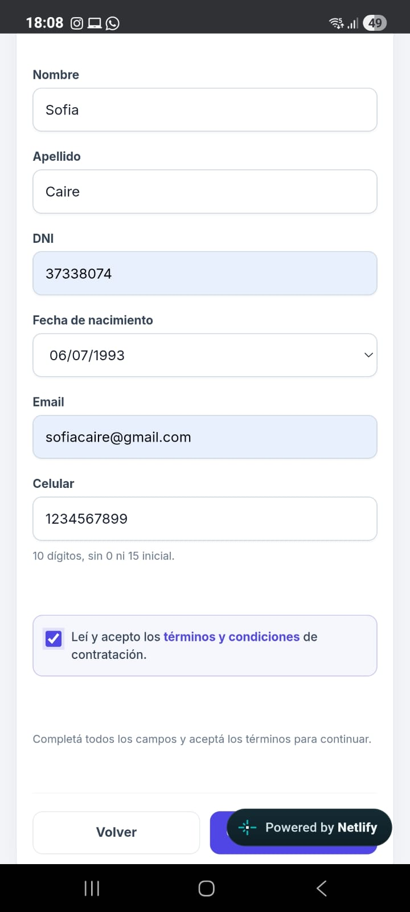

### Pago

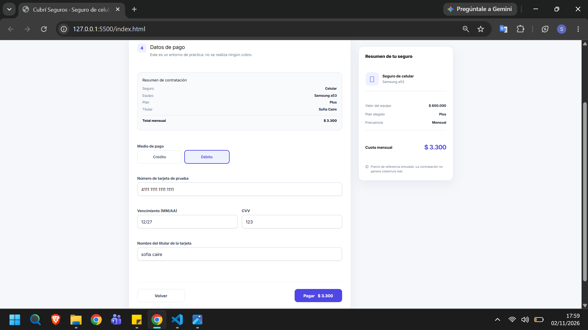

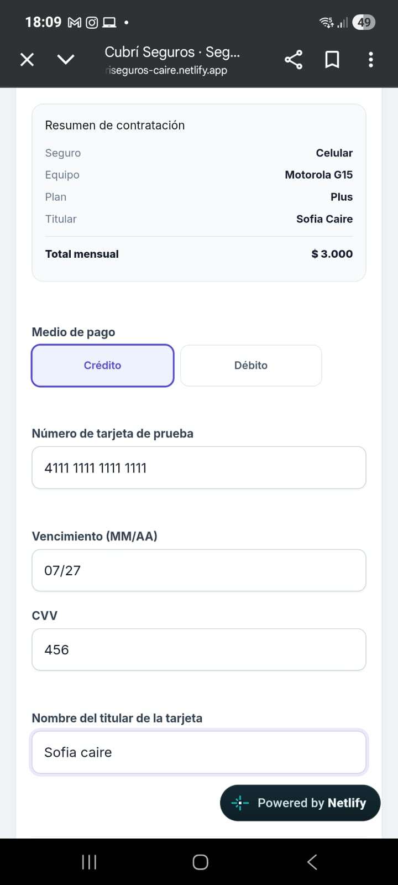

### Éxito

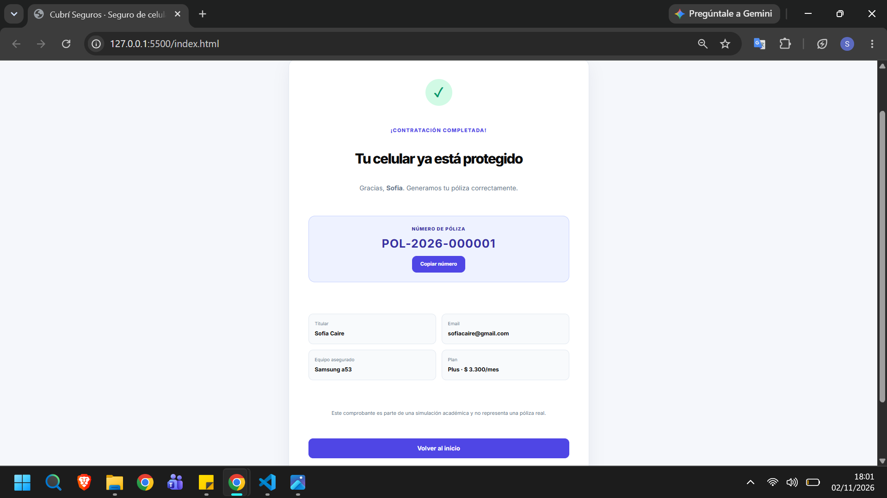

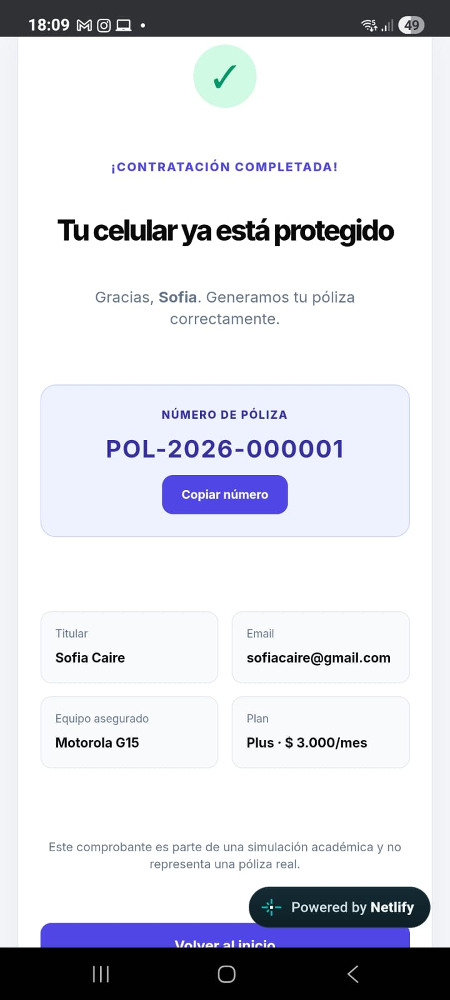

### Error

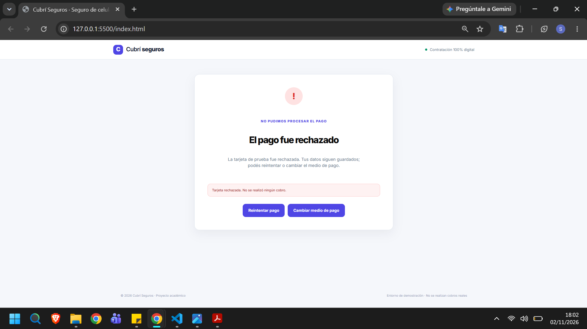

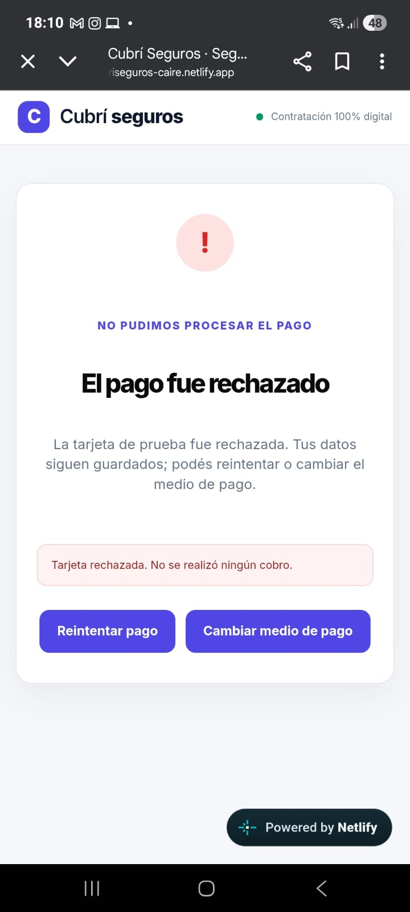

## Publicación

El proyecto está publicado en Netlify y conectado al repositorio de GitHub. Los cambios que subas al repositorio se despliegan automáticamente en el sitio.

## Alcance y decisiones

- No hay servidor, persistencia ni procesamiento de tarjetas real.
- El estado vive en un único objeto JS y los módulos se ocupan de responsabilidades específicas.
- Los planes se cargan desde `data/planes.json`; las cuotas se calculan con una sola función de cotización.
- Los términos son informativos para esta demo, no un contrato legal.
